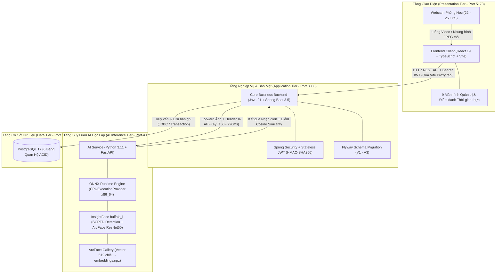
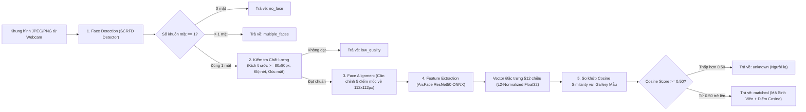
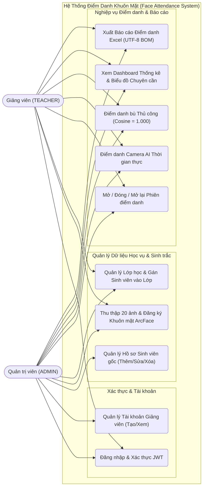
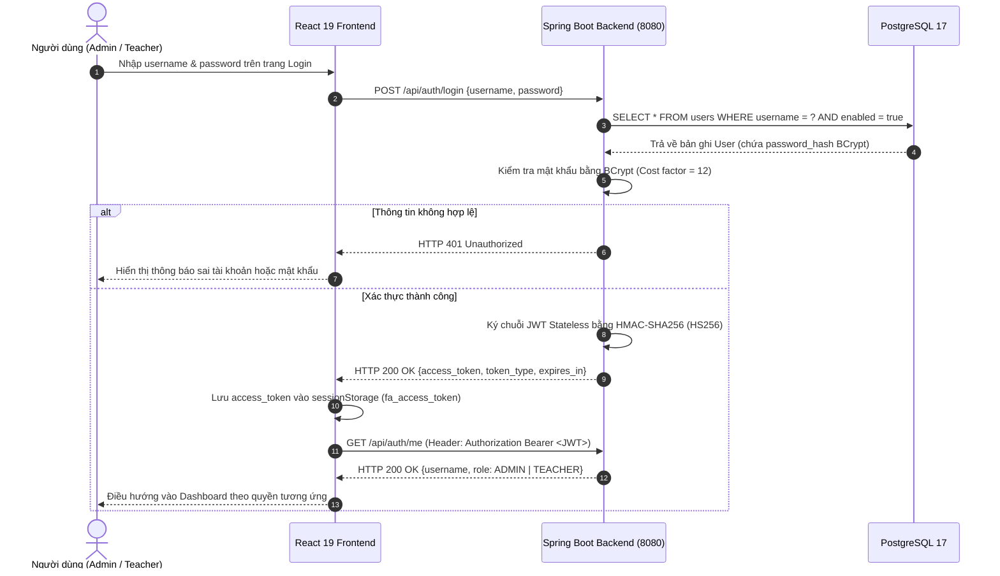
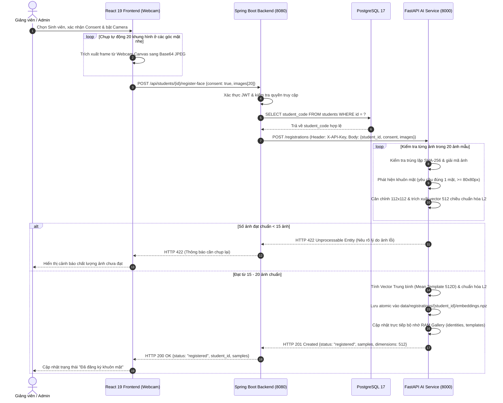
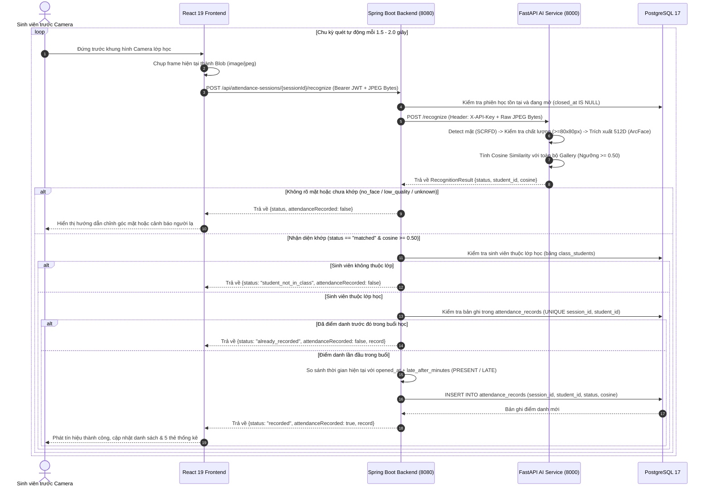
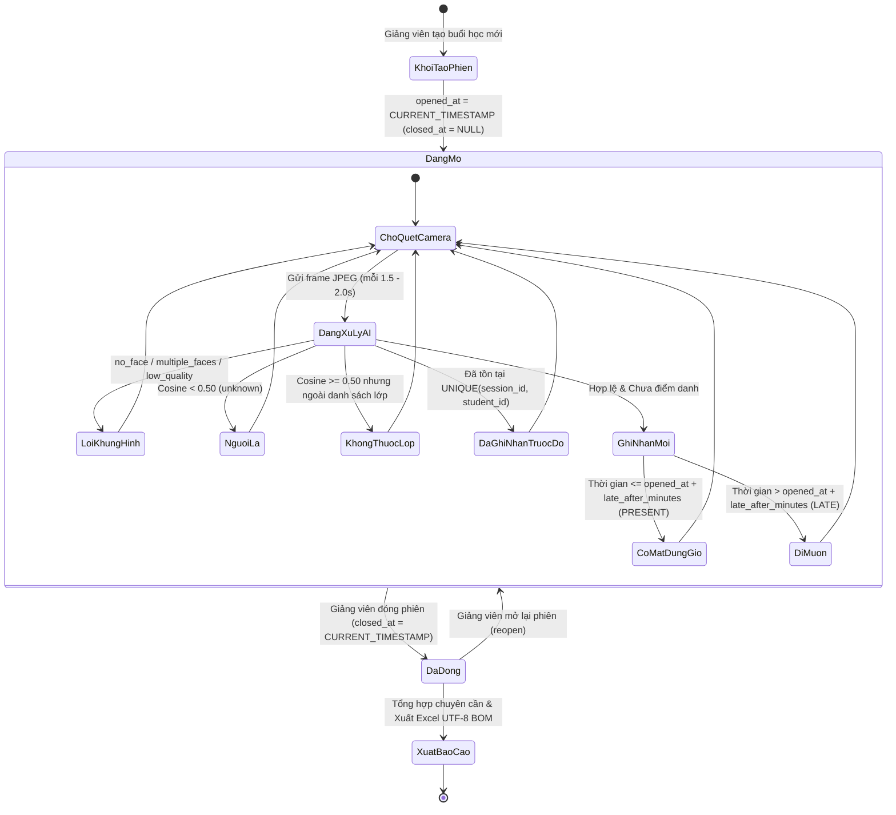
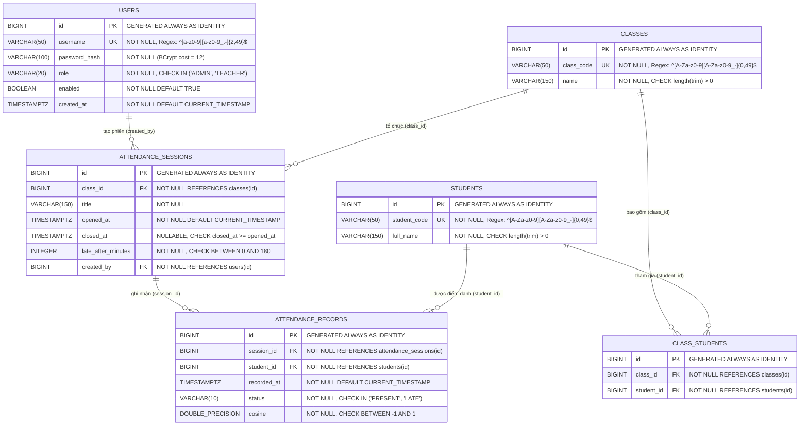
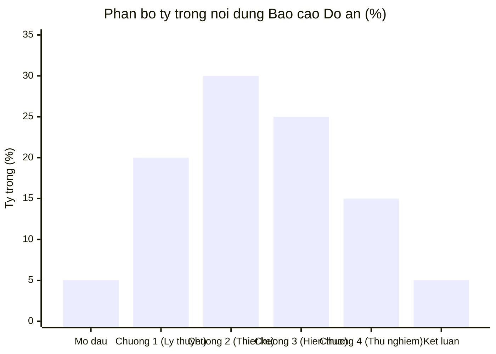
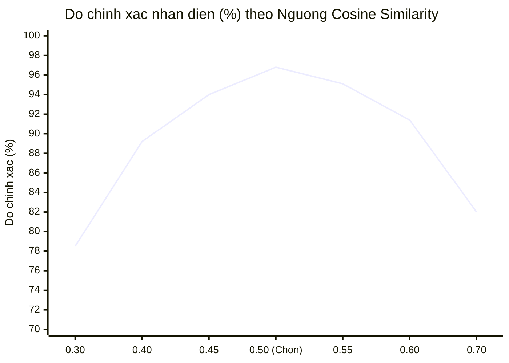

# Bộ Biểu Đồ & Sơ Đồ Kỹ Thuật Báo Cáo Đồ Án
**Đề tài:** Hệ thống Điểm danh Lớp học bằng Nhận diện Khuôn mặt (*Face Attendance System*)

Tài liệu này tổng hợp đầy đủ các biểu đồ kiến trúc, UML (Use Case, Sequence, State), cơ sở dữ liệu (ERD) và biểu đồ số liệu thực nghiệm bám sát đề cương `HUONG_DAN_LAM_BAO_CAO_DO_AN.txt` cùng mã nguồn thực tế của hệ thống.

---

## 1. Sơ đồ Kiến trúc Tổng thể Hệ thống (Decoupled Multi-Tier Architecture)
*(Dùng cho Chương 1 & Chương 2 — Thiết kế Kiến trúc Hệ thống)*

---

## 2. Sơ đồ Pipeline Xử lý & Nhận diện Khuôn mặt AI (ArcFace 512D)
*(Dùng cho Chương 1 — Mục 1.2: Cơ sở lý thuyết về Thị giác máy tính & Mô hình ArcFace)*

---

## 3. Biểu đồ Use Case Tổng quát & Phân quyền Hệ thống (RBAC)
*(Dùng cho Chương 2 — Mục 2.2 & 2.3: Phân quyền người dùng và Biểu đồ Use Case)*

---

## 4. Biểu đồ Tuần tự (Sequence Diagram) — Luồng 1: Đăng nhập & Xác thực JWT
*(Dùng cho Chương 2 — Mục 2.4.1: Luồng Đăng nhập và xác thực JWT)*

---

## 5. Biểu đồ Tuần tự (Sequence Diagram) — Luồng 2: Thu thập 20 Ảnh mẫu & Đăng ký Khuôn mặt
*(Dùng cho Chương 2 — Mục 2.4.2: Luồng Thu thập 20 ảnh mẫu và đăng ký khuôn mặt vào ArcFace Gallery)*

---

## 6. Biểu đồ Tuần tự (Sequence Diagram) — Luồng 3: Điểm danh Camera Thời gian thực
*(Dùng cho Chương 2 — Mục 2.4.3: Luồng Điểm danh camera trực tiếp thời gian thực)*

---

## 7. Biểu đồ Trạng thái Phiên Điểm danh & Kết quả Nhận diện (State Diagram)
*(Dùng cho Chương 2 & Chương 3 — Mô tả vòng đời phiên học và xử lý trạng thái điểm danh)*

---

## 8. Sơ đồ Thực thể Liên kết Cơ sở Dữ liệu (ERD - PostgreSQL 17)
*(Dùng cho Chương 2 — Mục 2.5: Thiết kế Cơ sở dữ liệu quan hệ)*

---

## 9. Biểu đồ Định lượng Bố cục Báo cáo & Thực nghiệm Hiệu năng
*(Dùng cho Phần Mở đầu & Chương 4 — Đánh giá Thực nghiệm)*

### 9.1. Phân bổ tỷ trọng trang theo cấu trúc báo cáo (Chuẩn 55 – 75 trang)

### 9.2. Độ chính xác nhận diện thực nghiệm theo Ngưỡng Cosine (Threshold = 0.50)

